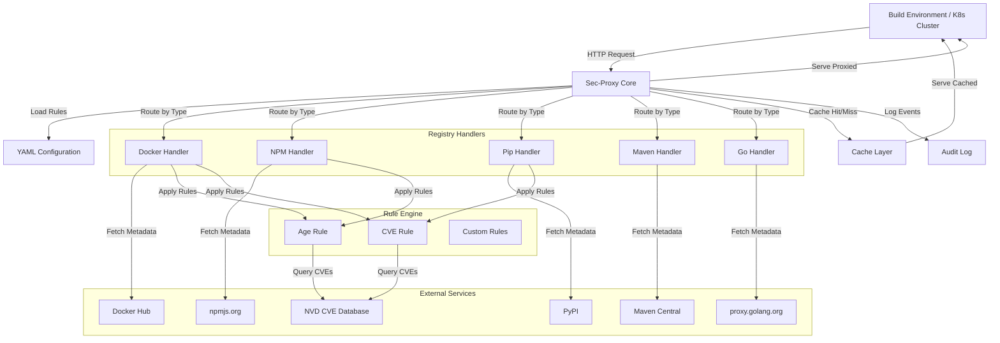

# Design Document: Secure Proxy (sec-proxy)

## Overview

The Secure Proxy (sec-proxy) is a security gateway that intercepts package requests from internal infrastructure and applies configurable security rules before proxying to external repositories. The system uses a plugin-based architecture where each package manager type (Docker, npm, pip, Maven, Go) has its own handler that understands the specific registry protocol and metadata format.

The core design principle is **intelligent version resolution with security policies**. When a client requests a package (especially with dynamic tags like "latest"), the proxy fetches metadata from the upstream registry, evaluates all available versions against configured rules (age thresholds, CVE checks, etc.), and transparently returns the newest compliant version. This allows builds to succeed while enforcing security policies.

**Important**: The proxy caches **metadata only** (package versions, publication dates, CVE information), not the actual package artifacts or images. This keeps storage requirements minimal while still providing fast policy evaluation. Package artifacts are always proxied directly from upstream registries.

## Architecture

### High-Level Architecture



### Request Flow

1. **Request Reception**: Client makes package request (e.g., `docker pull myimage:latest`)
2. **Handler Selection**: Proxy routes to appropriate handler based on request type
3. **Metadata Fetch**: Handler fetches package metadata from upstream registry (or from metadata cache if available)
4. **Rule Evaluation**: Handler applies configured rules to available versions
5. **Version Resolution**: Handler selects newest compliant version
6. **Package Proxy**: Proxy streams the resolved package directly from upstream to client
7. **Metadata Cache**: Store metadata for future requests
8. **Audit Log**: Log the request and security decision

## Components and Interfaces

### 1. Proxy Core

The central component that handles HTTP requests and coordinates between handlers, cache, and configuration.

```typescript
interface ProxyCore {
  // Start the proxy server
  start(config: ProxyConfig): Promise<void>
  
  // Handle incoming HTTP request
  handleRequest(req: HttpRequest): Promise<HttpResponse>
  
  // Route request to appropriate handler
  routeToHandler(req: HttpRequest): RegistryHandler
  
  // Reload configuration without downtime
  reloadConfig(config: ProxyConfig): Promise<void>
  
  // Health check endpoint
  healthCheck(): HealthStatus
}

interface HealthStatus {
  status: 'healthy' | 'degraded' | 'unhealthy'
  uptime: number
  cacheStatus: CacheHealth
  handlerStatus: Map<string, HandlerHealth>
}
```

### 2. Registry Handler Interface

Each package manager type implements this interface to handle registry-specific protocols.

```typescript
interface RegistryHandler {
  // Identify if this handler can process the request
  canHandle(req: HttpRequest): boolean
  
  // Fetch metadata for a package from upstream registry
  fetchMetadata(packageId: PackageIdentifier): Promise<PackageMetadata>
  
  // Resolve version tag to specific version based on rules
  resolveVersion(
    packageId: PackageIdentifier,
    requestedVersion: string,
    rules: Rule[]
  ): Promise<ResolvedVersion>
  
  // Fetch the actual package artifact
  fetchPackage(
    packageId: PackageIdentifier,
    version: string
  ): Promise<PackageArtifact>
  
  // Proxy the request to upstream (for non-package requests)
  proxyRequest(req: HttpRequest): Promise<HttpResponse>
}

interface PackageIdentifier {
  registry: string  // e.g., "docker.io", "registry.npmjs.org"
  namespace?: string  // e.g., "library" for Docker, "@scope" for npm
  name: string
}

interface PackageMetadata {
  packageId: PackageIdentifier
  versions: VersionInfo[]
  tags: Map<string, string>  // tag name -> version
}

interface VersionInfo {
  version: string
  publishedAt: Date
  checksums: Map<string, string>  // algorithm -> hash
  size: number
  metadata: Record<string, any>  // registry-specific metadata
}

interface ResolvedVersion {
  version: string
  reason: string  // explanation of why this version was selected
  rulesApplied: RuleResult[]
}
```

### 3. Rule Engine

The rule engine evaluates packages against configured security policies.

```typescript
interface Rule {
  // Unique identifier for the rule
  id: string
  
  // Human-readable name
  name: string
  
  // Evaluate a version against this rule
  evaluate(
    packageId: PackageIdentifier,
    version: VersionInfo,
    context: EvaluationContext
  ): Promise<RuleResult>
  
  // Check if this rule applies to the given package
  appliesTo(packageId: PackageIdentifier): boolean
}

interface RuleResult {
  ruleId: string
  passed: boolean
  severity: 'block' | 'warn' | 'info'
  message: string
  details?: Record<string, any>
}

interface EvaluationContext {
  currentTime: Date
  cveDatabase: CVEDatabase
  config: RuleConfig
}

// Age-based rule implementation
interface AgeRule extends Rule {
  minimumAgeDays: number
  exclusions: PackagePattern[]
}

// CVE-based rule implementation
interface CVERule extends Rule {
  maxSeverity: 'critical' | 'high' | 'medium' | 'low'
  blockOnCritical: boolean
  exclusions: PackagePattern[]
}

interface PackagePattern {
  registry?: string
  namespace?: string
  name?: string  // supports wildcards
}
```

### 4. Configuration System

YAML-based configuration with global and per-registry rules.

```typescript
interface ProxyConfig {
  // Global settings
  global: GlobalConfig
  
  // Per-registry configurations
  registries: Map<string, RegistryConfig>
  
  // Rule definitions
  rules: RuleDefinition[]
  
  // Cache configuration
  cache: CacheConfig
  
  // Audit logging configuration
  audit: AuditConfig
}

interface GlobalConfig {
  listenAddress: string
  listenPort: number
  tlsEnabled: boolean
  tlsCertPath?: string
  tlsKeyPath?: string
  defaultRules: string[]  // rule IDs to apply globally
}

interface RegistryConfig {
  type: 'docker' | 'npm' | 'pip' | 'maven' | 'go'
  upstreamUrl: string
  rules: string[]  // rule IDs to apply (overrides global)
  exclusions: RuleExclusion[]
  authentication?: RegistryAuth
}

interface RuleDefinition {
  id: string
  type: 'age' | 'cve' | 'custom'
  config: Record<string, any>
}

interface RuleExclusion {
  ruleId: string
  packages: PackagePattern[]
  reason: string
}

interface CacheConfig {
  backend: 'memory' | 'redis'
  ttlSeconds: number  // how long to cache metadata
  maxEntries: number  // maximum number of metadata entries
  evictionPolicy: 'lru' | 'lfu' | 'ttl'
}

interface AuditConfig {
  backend: 'file' | 'syslog' | 'cloudwatch'
  level: 'debug' | 'info' | 'warn' | 'error'
  includeRequestBody: boolean
}
```

Example YAML configuration:

```yaml
global:
  listenAddress: "0.0.0.0"
  listenPort: 8080
  defaultRules:
    - age-7days
    - cve-critical

rules:
  - id: age-7days
    type: age
    config:
      minimumAgeDays: 7
      
  - id: age-30days
    type: age
    config:
      minimumAgeDays: 30
      
  - id: cve-critical
    type: cve
    config:
      maxSeverity: critical
      blockOnCritical: true

registries:
  docker.io:
    type: docker
    upstreamUrl: "https://registry-1.docker.io"
    rules:
      - age-7days
      - cve-critical
    exclusions:
      - ruleId: age-7days
        packages:
          - name: "mycompany/*"
        reason: "Internal images are pre-vetted"
        
  registry.npmjs.org:
    type: npm
    upstreamUrl: "https://registry.npmjs.org"
    rules:
      - age-30days  # npm has more supply chain risk
      - cve-critical
    exclusions:
      - ruleId: age-30days
        packages:
          - name: "@mycompany/*"
        reason: "Internal packages"

cache:
  backend: memory
  ttlSeconds: 3600  # cache metadata for 1 hour
  maxEntries: 10000
  evictionPolicy: lru

audit:
  backend: file
  level: info
  includeRequestBody: false
```

### 5. Metadata Cache Layer

Stores fetched metadata (not package artifacts) to improve performance and reduce upstream API calls.

```typescript
interface MetadataCache {
  // Check if metadata is cached
  has(key: MetadataCacheKey): Promise<boolean>
  
  // Get cached metadata
  get(key: MetadataCacheKey): Promise<CachedMetadata | null>
  
  // Store metadata in cache
  put(key: MetadataCacheKey, metadata: PackageMetadata, ttl?: number): Promise<void>
  
  // Invalidate cached metadata
  invalidate(key: MetadataCacheKey): Promise<void>
  
  // Get cache statistics
  stats(): Promise<CacheStats>
  
  // Evict old entries based on policy
  evict(): Promise<number>
}

interface MetadataCacheKey {
  registry: string
  packageId: PackageIdentifier
}

interface CachedMetadata {
  metadata: PackageMetadata
  cacheMetadata: CacheMetadata
}

interface CacheMetadata {
  cachedAt: Date
  lastAccessedAt: Date
  accessCount: number
  ttl: number  // seconds
}

interface CacheStats {
  totalEntries: number
  hitRate: number
  evictionCount: number
  memoryUsage: number
}
```

### 6. Audit Logger

Records all security decisions and package requests for compliance.

```typescript
interface AuditLogger {
  // Log a package request
  logRequest(event: RequestEvent): Promise<void>
  
  // Log a security decision
  logDecision(event: DecisionEvent): Promise<void>
  
  // Log a cache event
  logCache(event: CacheEvent): Promise<void>
  
  // Query audit logs
  query(filter: AuditFilter): Promise<AuditEntry[]>
}

interface RequestEvent {
  timestamp: Date
  clientIp: string
  clientIdentity?: string
  packageId: PackageIdentifier
  requestedVersion: string
  userAgent: string
}

interface DecisionEvent {
  timestamp: Date
  packageId: PackageIdentifier
  version: string
  decision: 'allow' | 'block' | 'warn'
  rulesApplied: RuleResult[]
  resolvedVersion?: string
}

interface CacheEvent {
  timestamp: Date
  packageId: PackageIdentifier
  version: string
  eventType: 'hit' | 'miss' | 'evict' | 'invalidate'
}

interface AuditEntry {
  id: string
  timestamp: Date
  eventType: 'request' | 'decision' | 'cache'
  data: RequestEvent | DecisionEvent | CacheEvent
}
```

### 7. CVE Database Client

Interfaces with external vulnerability databases.

```typescript
interface CVEDatabase {
  // Query CVEs for a specific package version
  queryCVEs(
    packageId: PackageIdentifier,
    version: string
  ): Promise<CVEInfo[]>
  
  // Check if database is available
  isAvailable(): Promise<boolean>
}

interface CVEInfo {
  cveId: string
  severity: 'critical' | 'high' | 'medium' | 'low'
  score: number  // CVSS score
  description: string
  publishedDate: Date
  affectedVersions: string[]
  references: string[]
}
```

## Data Models

### Package Request Flow

```typescript
// Incoming request from client
interface IncomingRequest {
  method: string
  path: string
  headers: Map<string, string>
  body?: Buffer
}

// Parsed package request
interface PackageRequest {
  handler: string  // 'docker', 'npm', etc.
  packageId: PackageIdentifier
  requestedVersion: string
  originalRequest: IncomingRequest
}

// Response to client
interface PackageResponse {
  statusCode: number
  headers: Map<string, string>
  body: Buffer | ReadableStream
  cacheHit: boolean
}
```

### Registry-Specific Models

#### Docker

```typescript
interface DockerManifest {
  schemaVersion: number
  mediaType: string
  config: {
    digest: string
    size: number
  }
  layers: Array<{
    digest: string
    size: number
  }>
}

interface DockerImageMetadata {
  tags: string[]
  name: string
  created: Date
  architecture: string
}
```

#### NPM

```typescript
interface NPMPackageMetadata {
  name: string
  'dist-tags': Map<string, string>
  versions: Map<string, NPMVersionMetadata>
  time: Map<string, string>  // version -> ISO timestamp
}

interface NPMVersionMetadata {
  version: string
  dist: {
    tarball: string
    shasum: string
    integrity: string
  }
  dependencies: Map<string, string>
}
```

#### PyPI

```typescript
interface PyPIPackageMetadata {
  info: {
    name: string
    version: string
  }
  releases: Map<string, PyPIRelease[]>
}

interface PyPIRelease {
  filename: string
  url: string
  digests: Map<string, string>
  upload_time_iso_8601: string
  size: number
}
```

#### Maven

```typescript
interface MavenMetadata {
  groupId: string
  artifactId: string
  versioning: {
    latest: string
    release: string
    versions: string[]
    lastUpdated: string
  }
}

interface MavenArtifact {
  groupId: string
  artifactId: string
  version: string
  packaging: string
  checksums: Map<string, string>
}
```

#### Go Modules

```typescript
interface GoModuleInfo {
  Version: string
  Time: string  // RFC3339 timestamp
}

interface GoModuleMetadata {
  module: string
  versions: GoModuleInfo[]
}
```

## Correctness Properties

*A property is a characteristic or behavior that should hold true across all valid executions of a system—essentially, a formal statement about what the system should do. Properties serve as the bridge between human-readable specifications and machine-verifiable correctness guarantees.*


### Property 1: Package Proxying

*For any* package request (Docker, npm, pip, Maven, or Go), when the package is not cached, the proxy should fetch it from the configured upstream repository.

**Validates: Requirements 1.1, 2.1, 3.1, 4.1, 5.1**

### Property 2: Validation Before Serving

*For any* package fetched from upstream, the appropriate validation (vulnerability scan, checksum, signature) should be performed before the package is served to the client.

**Validates: Requirements 1.2, 2.2, 3.2, 4.2, 5.2**

### Property 3: Caching Metadata

*For any* package metadata fetched from upstream, the metadata should be stored in the cache layer for future requests.

**Validates: Requirements 1.3, 2.3, 3.3, 4.3, 5.3**

### Property 4: Metadata Cache Hit

*For any* cached package metadata, when the same package is requested again within the TTL, the metadata should be served from cache without fetching from upstream.

**Validates: Requirements 1.4, 2.4, 3.4, 4.4, 5.4**

### Property 5: Blocking Invalid Packages

*For any* package that fails validation (security scan, checksum, signature), the request should be blocked and an error returned to the client.

**Validates: Requirements 1.5, 2.5, 3.5, 4.5, 5.5**

### Property 6: Configuration Parsing

*For any* valid YAML configuration file, the proxy should successfully parse both global rules and per-registry rules.

**Validates: Requirements 6.1**

### Property 7: Global Rule Application

*For any* registry that does not have specific rules configured, the global rules should be applied to requests for that registry.

**Validates: Requirements 6.2**

### Property 8: Registry Rule Override

*For any* registry with specific rules configured, those rules should be applied instead of global rules.

**Validates: Requirements 6.3**

### Property 9: Rule Exclusions

*For any* package matching a configured exclusion pattern, the specified rule should not be applied to that package.

**Validates: Requirements 6.4**

### Property 10: Configuration Validation Errors

*For any* invalid YAML configuration, the proxy should report specific validation errors and refuse to start.

**Validates: Requirements 6.5, 14.2**

### Property 11: Publication Timestamp Retrieval

*For any* package request, the proxy should retrieve the publication timestamp from the registry metadata.

**Validates: Requirements 7.1**

### Property 12: Age-Based Filtering

*For any* package with a publication age less than the configured minimum age threshold (and not excluded), the request should be blocked.

**Validates: Requirements 7.2, 7.3**

### Property 13: Age Rule Exclusions

*For any* package matching an age rule exclusion pattern, the age check should be bypassed.

**Validates: Requirements 7.4**

### Property 14: Version Metadata Retrieval

*For any* request using a dynamic version tag (like "latest"), all available versions should be retrieved from the registry metadata.

**Validates: Requirements 8.1**

### Property 15: Newest Compliant Version Selection

*For any* set of package versions evaluated against age rules, the newest version that meets the age threshold should be selected.

**Validates: Requirements 8.2**

### Property 16: Transparent Version Resolution

*For any* dynamic version tag request where a compliant version exists, the resolved version should be transparently returned to the client.

**Validates: Requirements 8.3**

### Property 17: No Compliant Version Blocking

*For any* dynamic version tag request where no version meets the age threshold, the request should be blocked with an error explaining the policy violation.

**Validates: Requirements 8.4**

### Property 18: Specific Version Evaluation

*For any* request specifying an exact version, only that version should be evaluated against rules (not all available versions).

**Validates: Requirements 8.5**

### Property 19: Handler Routing

*For any* package request, the proxy should route it to the correct handler based on the registry type (Docker, npm, pip, Maven, Go).

**Validates: Requirements 9.1, 9.2, 9.3, 9.4, 9.5**

### Property 20: CVE Database Queries

*For any* package request (when CVE rules are enabled), the proxy should query the CVE database for known vulnerabilities in that package version.

**Validates: Requirements 10.1**

### Property 21: CVE Severity Evaluation

*For any* package with CVEs found, the severity scores should be evaluated against configured thresholds.

**Validates: Requirements 10.2**

### Property 22: Critical CVE Blocking

*For any* package with critical or high-severity CVEs (based on policy configuration), the package should be blocked.

**Validates: Requirements 10.3**

### Property 23: Low Severity CVE Handling

*For any* package with low or medium-severity CVEs, the CVEs should be logged and the configured policy action should be applied.

**Validates: Requirements 10.4**

### Property 24: Rule Interface Compatibility

*For any* rule implementation (built-in or custom), it should work through the common Rule interface.

**Validates: Requirements 11.1**

### Property 25: Rule Evaluation Order

*For any* package request with multiple applicable rules, the rules should be evaluated in the configured order.

**Validates: Requirements 11.2**

### Property 26: Rule Result Combination

*For any* package with multiple rule results, the results should be combined according to the configured logic (AND/OR).

**Validates: Requirements 11.3**

### Property 27: Rule Evaluation Error Handling

*For any* rule that fails during evaluation, the failure should be logged and remaining rules should continue to be evaluated.

**Validates: Requirements 11.4**

### Property 28: LRU Cache Eviction

*For any* metadata cache that reaches its configured entry limit, the least-recently-used metadata entries should be evicted.

**Validates: Requirements 12.1**

### Property 29: Cache Staleness

*For any* cached metadata that exceeds the configured TTL, it should be considered stale and re-fetched on the next request.

**Validates: Requirements 12.2**

### Property 30: Manual Cache Invalidation

*For any* administrator-requested cache invalidation, the specified metadata entries should be removed from the cache.

**Validates: Requirements 12.3**

### Property 31: Cache Statistics

*For any* cache statistics request, the response should include hit rates, entry count, and memory usage.

**Validates: Requirements 12.4**

### Property 32: Cache Persistence

*For any* proxy restart (when using Redis backend), the metadata cache should be persisted and available after restart.

**Validates: Requirements 12.5**

### Property 33: Distributed Cache Sharing

*For any* multi-instance deployment (when using Redis backend), metadata cache should be shared across all instances.

**Validates: Requirements 13.1**

### Property 34: Metadata Lookup Response Time

*For any* cached metadata lookup, the response time should be within 100ms.

**Validates: Requirements 13.2**

### Property 35: Offline Metadata Operation

*For any* cached metadata, when upstream repositories are unavailable, the metadata should still be available from cache for policy evaluation.

**Validates: Requirements 13.3**

### Property 36: Concurrent Request Handling

*For any* proxy instance, it should handle at least 1000 concurrent requests per second.

**Validates: Requirements 13.4**

### Property 37: Configuration Parsing on Startup

*For any* valid configuration file provided at startup, the proxy should successfully parse and validate it.

**Validates: Requirements 14.1**

### Property 38: Hot Configuration Reload

*For any* configuration change detected at runtime, the new settings should be applied without dropping existing connections.

**Validates: Requirements 14.3**

### Property 39: Configuration Completeness

*For any* proxy configuration, it should support settings for upstream repositories, policies, cache settings, and security thresholds.

**Validates: Requirements 14.4**

### Property 40: Health Check Endpoint

*For any* health check request, the endpoint should return configuration status and system health information.

**Validates: Requirements 14.5**

### Property 41: Audit Logging for Requests

*For any* package request received, the request details should be logged to the audit log.

**Validates: Requirements 8.1**

### Property 42: Audit Logging for Decisions

*For any* security decision made (allow/block/warn), the decision, reasoning, and applicable rules should be logged to the audit log.

**Validates: Requirements 8.2**

### Property 43: Audit Logging for Cache Events

*For any* metadata cache event (hit/miss/evict/invalidate), the event should be logged to the audit log.

**Validates: Requirements 8.3**

### Property 44: Audit Log Blocking Details

*For any* blocked package, the audit log should include the block reason, policy rule, and relevant security data (age, CVEs).

**Validates: Requirements 8.4**

### Property 45: Audit Log Completeness

*For any* audit log entry, it should include timestamps, client identity, package details, and security outcomes.

**Validates: Requirements 8.5**

## Error Handling

### Error Categories

1. **Upstream Errors**: Registry unavailable, network timeouts, invalid responses
2. **Validation Errors**: Checksum mismatch, signature verification failure, malformed metadata
3. **Policy Errors**: Age threshold violation, CVE threshold violation, blocked by policy
4. **Configuration Errors**: Invalid YAML, missing required fields, conflicting rules
5. **Cache Errors**: Cache full, cache corruption, cache backend unavailable
6. **System Errors**: Out of memory, disk full, database connection failure

### Error Handling Strategy

```typescript
interface ErrorResponse {
  statusCode: number
  errorCode: string
  message: string
  details?: Record<string, any>
  retryable: boolean
}

// Error handling for upstream failures
class UpstreamError extends Error {
  constructor(
    public registry: string,
    public cause: Error,
    public retryable: boolean
  ) {
    super(`Upstream registry ${registry} error: ${cause.message}`)
  }
}

// Error handling for policy violations
class PolicyViolationError extends Error {
  constructor(
    public packageId: PackageIdentifier,
    public version: string,
    public violations: RuleResult[]
  ) {
    super(`Package ${packageId.name}:${version} violates policy`)
  }
}

// Error handling for validation failures
class ValidationError extends Error {
  constructor(
    public packageId: PackageIdentifier,
    public version: string,
    public validationType: string,
    public details: string
  ) {
    super(`Validation failed for ${packageId.name}:${version}: ${details}`)
  }
}
```

### Fallback Behavior

1. **Upstream Unavailable**: Use cached metadata if available for policy evaluation, proxy request will fail if package not accessible
2. **CVE Database Unavailable**: Apply configured fallback (block, allow, or warn)
3. **Cache Backend Unavailable**: Continue proxying without metadata caching (degraded mode, all metadata fetched from upstream)
4. **Partial Metadata**: Use available metadata, log warning, apply conservative policy

### Circuit Breaker

Implement circuit breaker pattern for upstream registries:
- After N consecutive failures, open circuit (stop trying)
- After timeout period, attempt one request (half-open)
- If successful, close circuit (resume normal operation)
- If failed, reopen circuit

## Testing Strategy

### Dual Testing Approach

This project will use both unit tests and property-based tests to ensure comprehensive coverage:

- **Unit tests**: Verify specific examples, edge cases, and error conditions
- **Property-based tests**: Verify universal properties across all inputs

Both types of tests are complementary and necessary. Unit tests catch concrete bugs in specific scenarios, while property-based tests verify general correctness across a wide range of inputs.

### Property-Based Testing

We will use **fast-check** (for TypeScript/JavaScript) as our property-based testing library. Each correctness property listed above will be implemented as a property-based test.

**Configuration**:
- Minimum 100 iterations per property test
- Each test must reference its design document property
- Tag format: `Feature: sec-proxy, Property N: [property text]`

**Example Property Test**:

```typescript
import fc from 'fast-check'

// Feature: sec-proxy, Property 4: Metadata Cache Hit
test('cached metadata is served without upstream fetch', () => {
  fc.assert(
    fc.property(
      fc.record({
        packageId: arbitraryPackageId(),
        metadata: arbitraryPackageMetadata()
      }),
      async ({ packageId, metadata }) => {
        // Setup: cache the metadata
        await metadataCache.put({ packageId }, metadata)
        
        // Mock upstream to track if it's called
        const upstreamMock = jest.fn()
        upstream.fetchMetadata = upstreamMock
        
        // Act: request metadata for the cached package
        await handler.fetchMetadata(packageId)
        
        // Assert: upstream was not called
        expect(upstreamMock).not.toHaveBeenCalled()
      }
    ),
    { numRuns: 100 }
  )
})
```

### Unit Testing

Unit tests will focus on:

1. **Specific Examples**: Test known package requests with expected outcomes
2. **Edge Cases**: Empty metadata, missing timestamps, malformed checksums
3. **Error Conditions**: Network failures, invalid configurations, cache corruption
4. **Integration Points**: Handler selection, rule evaluation, cache operations

**Example Unit Test**:

```typescript
describe('Age Rule', () => {
  test('blocks package published yesterday with 7-day threshold', async () => {
    const yesterday = new Date(Date.now() - 24 * 60 * 60 * 1000)
    const packageInfo = {
      packageId: { name: 'test-package' },
      version: '1.0.0',
      publishedAt: yesterday
    }
    
    const rule = new AgeRule({ minimumAgeDays: 7 })
    const result = await rule.evaluate(packageInfo, {
      currentTime: new Date()
    })
    
    expect(result.passed).toBe(false)
    expect(result.severity).toBe('block')
  })
  
  test('allows package published 30 days ago with 7-day threshold', async () => {
    const thirtyDaysAgo = new Date(Date.now() - 30 * 24 * 60 * 60 * 1000)
    const packageInfo = {
      packageId: { name: 'test-package' },
      version: '1.0.0',
      publishedAt: thirtyDaysAgo
    }
    
    const rule = new AgeRule({ minimumAgeDays: 7 })
    const result = await rule.evaluate(packageInfo, {
      currentTime: new Date()
    })
    
    expect(result.passed).toBe(true)
  })
})
```

### Test Organization

```
tests/
├── unit/
│   ├── handlers/
│   │   ├── docker.test.ts
│   │   ├── npm.test.ts
│   │   ├── pip.test.ts
│   │   ├── maven.test.ts
│   │   └── go.test.ts
│   ├── rules/
│   │   ├── age-rule.test.ts
│   │   ├── cve-rule.test.ts
│   │   └── rule-engine.test.ts
│   ├── cache/
│   │   ├── memory-cache.test.ts
│   │   ├── redis-cache.test.ts
│   │   └── cache-eviction.test.ts
│   └── config/
│       └── yaml-parser.test.ts
├── property/
│   ├── proxying.property.test.ts
│   ├── metadata-caching.property.test.ts
│   ├── rules.property.test.ts
│   └── version-resolution.property.test.ts
└── integration/
    ├── end-to-end.test.ts
    └── multi-registry.test.ts
```

### Test Generators (Arbitraries)

For property-based testing, we need generators for domain objects:

```typescript
// Generate random package identifiers
function arbitraryPackageId(): fc.Arbitrary<PackageIdentifier> {
  return fc.record({
    registry: fc.constantFrom('docker.io', 'registry.npmjs.org', 'pypi.org'),
    namespace: fc.option(fc.string()),
    name: fc.string({ minLength: 1 })
  })
}

// Generate random version info
function arbitraryVersionInfo(): fc.Arbitrary<VersionInfo> {
  return fc.record({
    version: fc.string({ minLength: 1 }),
    publishedAt: fc.date(),
    checksums: fc.dictionary(fc.string(), fc.hexaString()),
    size: fc.nat(),
    metadata: fc.object()
  })
}

// Generate random package metadata
function arbitraryPackageMetadata(): fc.Arbitrary<PackageMetadata> {
  return fc.record({
    packageId: arbitraryPackageId(),
    versions: fc.array(arbitraryVersionInfo(), { minLength: 1 }),
    tags: fc.dictionary(fc.string(), fc.string())
  })
}

// Generate random rule configurations
function arbitraryAgeRuleConfig(): fc.Arbitrary<AgeRuleConfig> {
  return fc.record({
    minimumAgeDays: fc.integer({ min: 1, max: 365 })
  })
}
```

### Performance Testing

In addition to functional tests, we will include performance tests:

1. **Latency Tests**: Verify cached responses are under 100ms
2. **Throughput Tests**: Verify 1000+ requests/second handling
3. **Load Tests**: Verify behavior under sustained high load
4. **Stress Tests**: Verify graceful degradation under extreme load

### Security Testing

1. **Fuzzing**: Generate malformed requests and configurations
2. **Injection Tests**: Test for command injection, path traversal
3. **Authentication Tests**: Verify proper credential handling
4. **TLS Tests**: Verify secure communication

## Implementation Notes

### Technology Stack

- **Language**: Go (for performance, concurrency, and infrastructure tooling ecosystem)
- **HTTP Server**: Standard library `net/http` or `gorilla/mux` for routing
- **Cache Backend**: Redis (for distributed metadata caching) or in-memory with `sync.Map` (for simple deployments)
- **Configuration**: `gopkg.in/yaml.v3` for YAML parsing with struct validation
- **Testing**: Standard library `testing` + `github.com/leanovate/gopter` for property-based testing
- **Logging**: `go.uber.org/zap` or `github.com/rs/zerolog` (structured logging)
- **Metrics**: `github.com/prometheus/client_golang`

### Deployment Considerations

1. **Container Image**: Provide official Docker image
2. **Kubernetes**: Provide Helm chart with HA configuration
3. **Configuration**: Support ConfigMaps and Secrets
4. **Monitoring**: Export Prometheus metrics
5. **Health Checks**: Liveness and readiness probes

### Security Considerations

1. **TLS**: Support TLS for client connections
2. **Authentication**: Support basic auth, token auth, mTLS
3. **Authorization**: Support per-registry access control
4. **Secrets**: Never log credentials or tokens
5. **Validation**: Strict input validation on all requests

### Performance Optimizations

1. **Connection Pooling**: Reuse connections to upstream registries
2. **Streaming**: Stream large packages without buffering in memory
3. **Compression**: Support gzip/brotli compression for metadata responses
4. **Parallel Fetching**: Fetch metadata and CVE data in parallel
5. **Metadata Caching**: Cache metadata separately with appropriate TTLs to reduce upstream API calls

### Observability

1. **Metrics**: Request rate, error rate, latency, cache hit rate
2. **Tracing**: Distributed tracing for request flows
3. **Logging**: Structured logs with correlation IDs
4. **Dashboards**: Pre-built Grafana dashboards
5. **Alerts**: Alert rules for common issues
